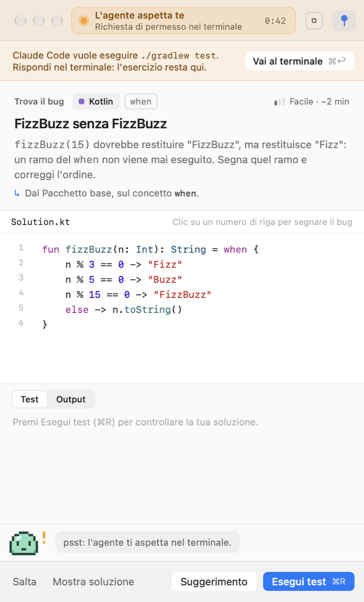
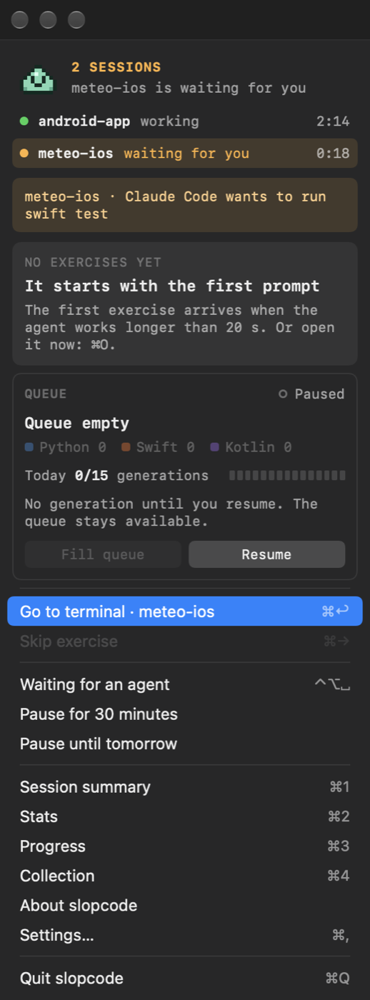

# Slop2Skill

Coding practice while your AI agent works. When Claude Code is thinking, you're training: a macOS menu bar app that opens a short exercise next to your terminal, in Python, Swift or Kotlin.

**[Download Slop2Skill for macOS](https://github.com/federix-ai/slop2skill-app/releases/latest/download/slop2skill.zip)** · [project page](https://federix-ai.github.io/slop2skill-app/)

 

## Requirements

- macOS 26 or later. English and Italian.
- [Claude Code](https://docs.anthropic.com/en/docs/claude-code/setup) with a Claude subscription, for exercises generated by Claude Haiku. Without it, a built-in exercise pack is available.
- At least one language: `python3`, Xcode's command line tools for Swift, or `kotlinc` with a JDK.

## First launch

This version is not notarized yet, so macOS blocks it on first launch. Move the app to Applications, open it once, then go to **System Settings › Privacy & Security** and click **Open Anyway**.

## Privacy

Progress and statistics stay on your Mac. Exercises are generated by Claude through your own Claude Code, on your subscription and never with an API key; your projects' code is read strictly read-only and only if you allow it.

Slop2Skill's source code is not public. This repository only hosts the page and the downloadable releases.
