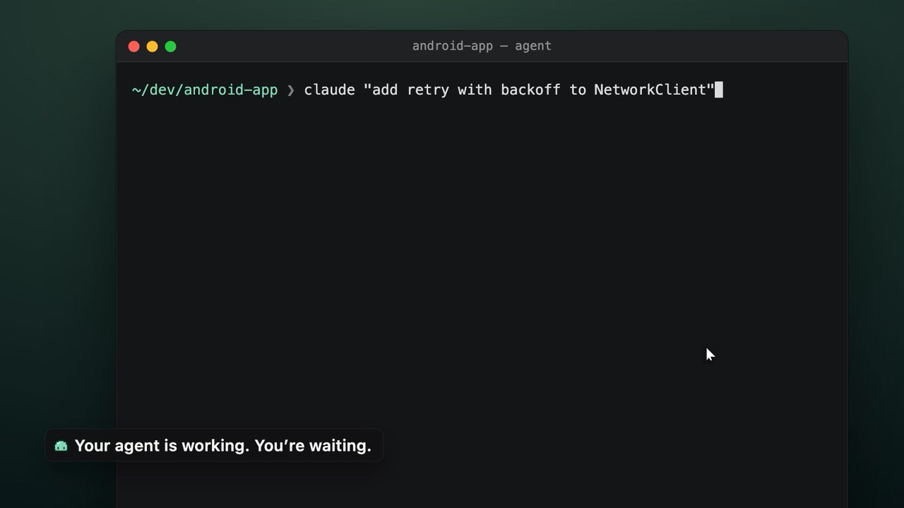
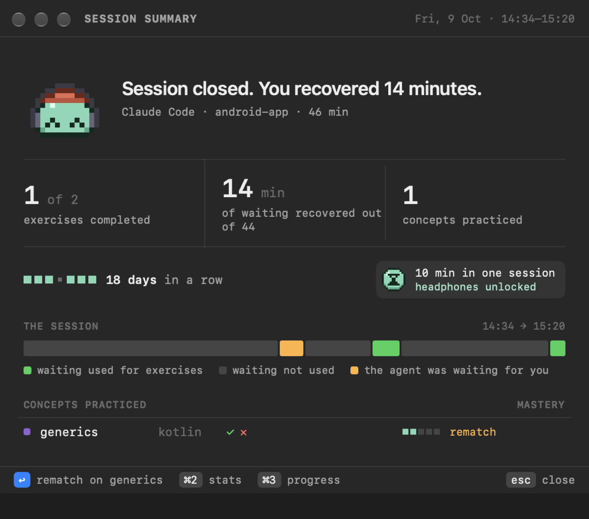
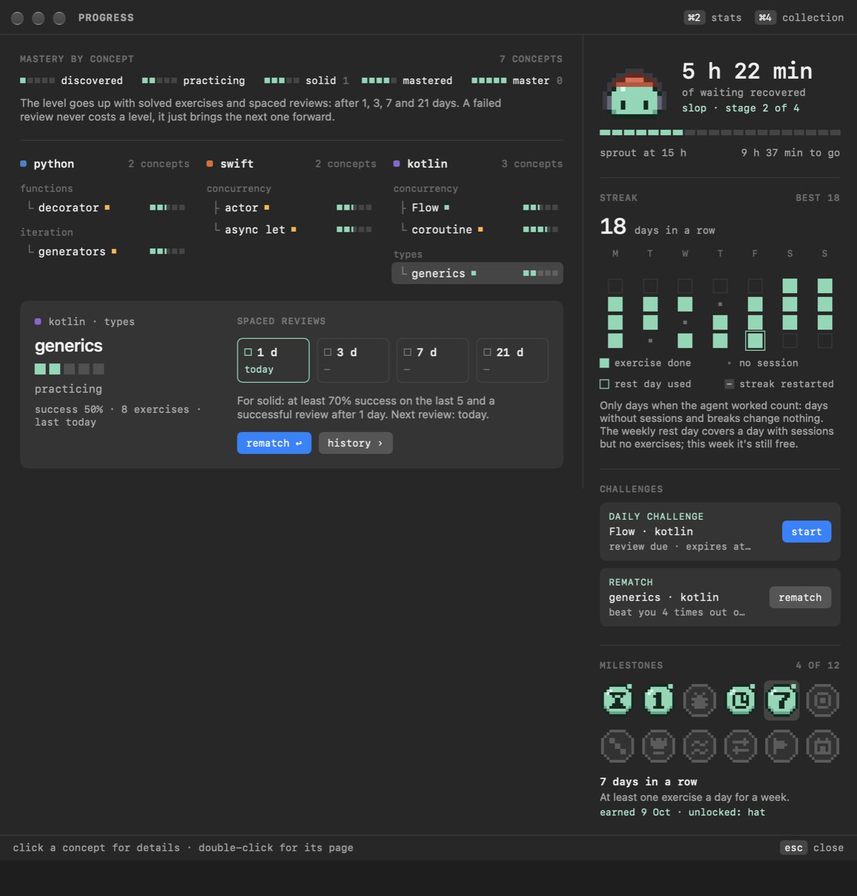
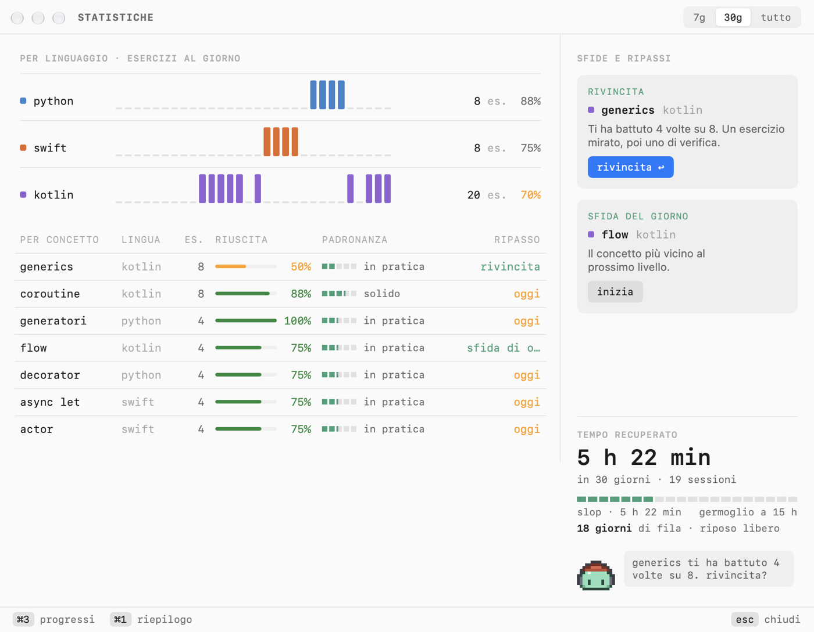

  

<h1 align="center">Slop2Skill</h1>

  <b>Your agent is working. Don't just wait.</b> 
  A macOS menu bar app that opens a short coding exercise next to your terminal 
  whenever Claude Code or Codex gets busy.

  <a href="https://github.com/federix-ai/slop2skill-app/releases/latest/download/slop2skill.zip"><b>⬇ Download for macOS</b></a>
  &nbsp;·&nbsp;
  <a href="https://federix-ai.github.io/slop2skill-app/">Project page</a>
  &nbsp;·&nbsp;
  <a href="https://github.com/federix-ai/slop2skill-app/releases">Releases</a>

  
  
  
  

  
   
  ▶ Watch the 40-second demo

---

## Train in the minutes you'd lose anyway

You ask an agent to add a feature, then stare at a spinner. Slop2Skill turns that wait into reps: the moment Claude Code or Codex starts working, a slim window opens next to your terminal with a small exercise. No focus stealing, no account, nothing to schedule.

<table>
  <tr>
    <td width="50%" valign="top">
      <h3>🏋️ Reps while the agent works</h3>
      Write a function, hunt a bug or answer a question in <b>Python, Swift or Kotlin</b>. Tests run on your Mac with <kbd>⌘</kbd><kbd>R</kbd>.
    </td>
    <td width="50%" valign="top">
      <h3>🧬 Exercises from your own code</h3>
      Inspired by the files your agent is touching, rewritten from scratch. Your project is only read, never changed.
    </td>
  </tr>
  <tr>
    <td valign="top">
      <h3>🫧 It lives in the menu bar</h3>
      One icon for every agent session. It tells you when the agent needs you, and your exercise waits where you left it.
    </td>
    <td valign="top">
      <h3>🌱 Every wait grows your slop</h3>
      Mastery per concept, spaced reviews, a pressure-free streak and a mascot that grows with the hours you win back.
    </td>
  </tr>
</table>

## See it

  
  &nbsp;
  

  
  
  

The exercise window · the menu bar · session summary · progress · statistics

## How it works

1. **Your agent gets to work.** Slop2Skill notices when Claude Code (or Codex) starts and opens the exercise window next to your terminal.
2. **You practice.** A short exercise in your language, with hints. Tests run locally.
3. **You grow.** Mastery, spaced reviews and the mascot track the waiting time you put to use.

### Where the exercises come from

- **Written by Claude Haiku**, in a hidden Claude Code session on your own subscription. Never an API key.
- **Only when your agent is idle**, within the daily and weekly limits you choose.
- **Verified before you see them:** the reference solution must pass the tests, and the starter code must not.
- **Works out of the box:** no Claude Code yet? A built-in exercise pack is ready from the first launch.

## Install

1. [Download `slop2skill.zip`](https://github.com/federix-ai/slop2skill-app/releases/latest/download/slop2skill.zip), open it and move **Slop2Skill** to Applications.
2. Open the app. macOS will block it: dismiss the alert.
3. Go to **System Settings › Privacy & Security** and click **Open Anyway** next to Slop2Skill.
4. The mascot appears in the menu bar and a six-step setup starts.

> [!NOTE]
> The app is not notarized by Apple yet, so macOS asks you to allow it once.

### Requirements

| | |
|---|---|
| **System** | macOS 26 or later, Apple Silicon or Intel. English and Italian. |
| **Agent** | [Claude Code](https://docs.anthropic.com/en/docs/claude-code/setup) with a Claude subscription for generated exercises (Codex is followed too). |
| **To run tests** | `python3` for Python, Xcode's command line tools for Swift (`xcode-select --install`), `kotlinc` plus a JDK for Kotlin (`brew install kotlin openjdk`). One language is enough. |

## Privacy

- **Stays on your Mac.** No account, no servers. Progress and statistics never leave it.
- **Never your conversations.** From Claude Code hooks it only receives the event, the folder and the names of the files touched.
- **Asks before editing** `~/.claude/settings.json`, and makes a backup first. Uninstalling removes only the lines it added.

---

  Slop2Skill's source code is not public: this repository only hosts the project page and the downloadable releases.

